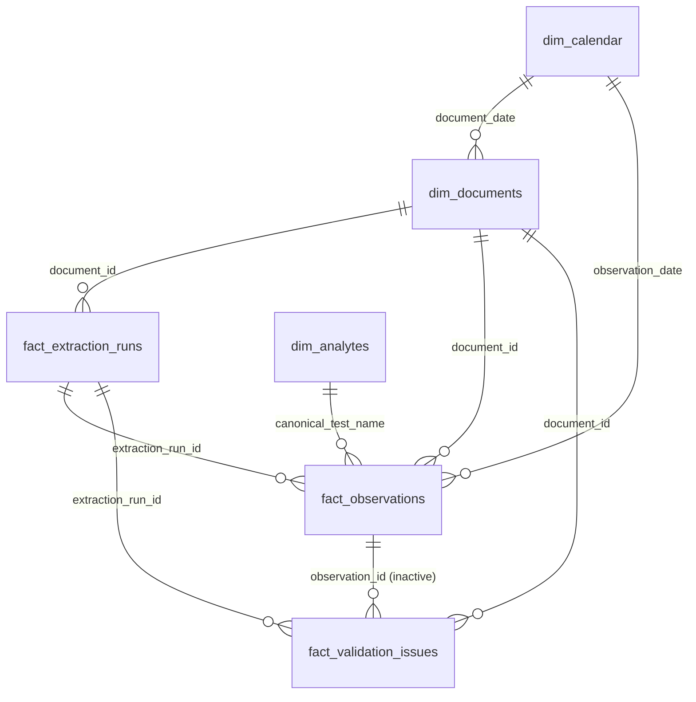

# VitalTrace Analytics — Power BI Semantic Model & Dashboard Guide

> **Target Role:** Innovaccer Data Analyst Intern  
> **Platform Version:** Power BI Desktop (May 2024 or later) / Power BI Service  
> **Repository Module:** `powerbi/`  
> **Author:** VitalTrace Data Engineering & Clinical Analytics Team  

---

## 1. Executive Notice: Binary PBIX Packaging Limitation

> [!IMPORTANT]
> **Why `VitalTrace_Analytics.pbix` Is Not Checked into Git Directly:**  
> Power BI `.pbix` files are proprietary, compressed binary archive packages (Microsoft Compound File Binary / ZIP container containing `DataModelSchema`, `Layout`, `PackageMetadata`, and local VertiPaq database structures). Generating `.pbix` files directly in headless CLI/Linux/Cloud environments without the Power BI Desktop Windows GUI executable causes database corruption and is unsupported by Microsoft.  
>  
> Instead, this repository delivers **100% complete, production-grade source code artifacts**:
> 1. **Data Model & Dimensions:** Curated CSV test fixtures in `powerbi/data/`
> 2. **ETL Pipeline:** Complete Power Query M transformation scripts in `powerbi/PowerQuery_M.pq`
> 3. **Semantic Measures:** Formatted DAX business calculations in `powerbi/DAX_Measures.dax`
> 4. **Visual Theme:** Healthcare SaaS corporate design system in `powerbi/vitaltrace_theme.json`
> 5. **End-to-End Build Guide:** Step-by-step instructions below to produce the identical `.pbix` in under 5 minutes.

---

## 2. Dashboard Architecture Overview

The completed `VitalTrace_Analytics.pbix` artifact is structured into **4 Analytical Report Pages**:

| Page # | Report Name | Target Audience | Primary Focus & Visuals |
|---|---|---|---|
| **Page 1** | **Executive Overview** | Clinical Directors, Platform Leads | KPI scorecards (Total Docs, Success Rate %, Unique Documents Processed, Retry Rate %, Observations Extracted vs Confirmed, Review Backlog), Ingestion Trends over time, Verification Funnel. |
| **Page 2** | **Data Quality & Governance** | Data Quality Stewards, ML Engineers | Discrepancy breakdown by category (missing units, missing values, duplicate test entries, unmapped aliases), Resolution Rate %, Validation Pass Rate %, Open vs Resolved backlogs. |
| **Page 3** | **Pipeline Performance** | Infrastructure & Platform Engineers | Latency distribution, P50 (median) & P95 (tail) latency, processing duration by file size, error classification, retry frequency, SLA compliance % (<= 5s). |
| **Page 4** | **Analytical Explorer** | Clinical Research Analysts | Full interactive matrix and drill-through tables by patient profile, document type, canonical test LOINC hierarchy, and observation longitudinal history. |

---

## 3. Data Model & Star Schema Relationships

### Key Cardinalities & Cross-Filter Directions:
- `dim_documents` (1) ➔ `fact_extraction_runs` (Many) — Single cross-filter direction
- `dim_documents` (1) ➔ `fact_observations` (Many) — Single cross-filter direction
- `dim_documents` (1) ➔ `fact_validation_issues` (Many) — Single cross-filter direction
- `dim_analytes` (1) ➔ `fact_observations` (Many) — Single cross-filter direction
- `dim_calendar` (1) ➔ `fact_observations` (Many) on `observation_date` — Active
- `dim_calendar` (1) ➔ `dim_documents` (Many) on `document_date` — Inactive (use `USERELATIONSHIP`)

---

## 4. Step-by-Step Instructions: Assembling `VitalTrace_Analytics.pbix`

Follow these exact steps in Power BI Desktop to build the production `.pbix`:

### Step 1: Open Power BI Desktop & Apply Healthcare Theme
1. Launch **Power BI Desktop**.
2. Click **View** tab in the top ribbon ➔ Expand the **Themes** gallery ➔ Click **Browse for themes...**
3. Select `c:\Users\srsp1\OneDrive\Documents\VitalTrace\powerbi\vitaltrace_theme.json`.
4. *Result:* Your color palette is now configured with VitalTrace primary teal (`#0d9488`), clean white cards, soft shadows, and slate typography.

### Step 2: Ingest the Semantic Model via Power Query M
1. In the **Home** tab, click **Transform Data** to open the **Power Query Editor**.
2. Create the global parameters (**Home** ➔ **Manage Parameters** ➔ **New Parameter**):
   - `DataSourceMode`: Type = `Text`, Current Value = `CSV` (or `PostgreSQL`)
   - `CsvFolderPath`: Type = `Text`, Current Value = `c:\Users\srsp1\OneDrive\Documents\VitalTrace\powerbi\data`
   - `PgServerHost`: Type = `Text`, Current Value = `aws-0-ap-southeast-2.pooler.supabase.com`
   - `PgDatabaseName`: Type = `Text`, Current Value = `postgres`
3. For each table, click **New Source** ➔ **Blank Query** ➔ **Advanced Editor**, then paste the corresponding M query from `powerbi/PowerQuery_M.pq`:
   - `dim_documents`
   - `fact_extraction_runs`
   - `fact_observations`
   - `fact_validation_issues`
   - `dim_analytes`
   - `dim_calendar`
4. Click **Close & Apply** on the top left ribbon.

### Step 3: Establish Model Relationships
Navigate to the **Model View** (left navigation rail):
1. Connect `dim_documents[id]` (1) ➔ `fact_extraction_runs[document_id]` (*)
2. Connect `dim_documents[id]` (1) ➔ `fact_observations[document_id]` (*)
3. Connect `dim_documents[id]` (1) ➔ `fact_validation_issues[document_id]` (*)
4. Connect `dim_analytes[canonical_test_name]` (1) ➔ `fact_observations[canonical_test_name]` (*)
5. Connect `dim_calendar[date]` (1) ➔ `fact_observations[observation_date]` (*)
6. Set `dim_calendar` as an official Date Table: Right-click `dim_calendar` ➔ **Mark as date table** ➔ Select `date`.

### Step 4: Add DAX Measures
1. On the **Home** tab, click **Enter Data**. Name the table `_Measures` and click **Load**.
2. Open `powerbi/DAX_Measures.dax`.
3. For each measure block, click **New Measure** in the ribbon and paste the definition.
4. Set measure formatting:
   - Percentages (`Retry Rate %`, `Run Success Rate %`, `Confirmation Rate %`, `Validation Pass Rate %`, `Issue Resolution Rate %`, `Failure Rate %`): Set format to **Percentage** (1 decimal place).
   - Durations (`Avg Processing Duration (s)`, `P50 Latency (s)`, `P95 Latency (s)`): Set format to **Decimal number** (2 decimal places).
   - Counts (`Total Documents`, `Total Observations`, etc.): Set format to **Whole number** with thousands separator.

### Step 5: Build Visuals Across the 4 Report Pages

#### Page 1: Executive Overview
- **Row 1 (KPI Cards):**
  - Card 1: `[Total Documents]`
  - Card 2: `[Unique Documents Processed]`
  - Card 3: `[Run Success Rate %]` (Conditional color: >= 80% Green `#10b981`, else Red `#ef4444`)
  - Card 4: `[Retry Rate %]`
  - Card 5: `[Confirmation Rate %]`
  - Card 6: `[Pending Review]` (Badge: `[Review Backlog Priority Flag]`)
- **Row 2 (Visuals):**
  - Area Chart: Processing Volume Over Time (`dim_calendar[date]` on X-axis, `[Total Extraction Runs]` and `[Total Observations]` on Y-axis).
  - Funnel Chart: Verification Funnel (`fact_observations[verified_by_user]` on Category, `[Total Observations]` on Values).
  - Donut Chart: Document Processing Status (`dim_documents[processing_status]` on Legend, `[Total Documents]` on Values).

#### Page 2: Data Quality & Clinical Governance
- **Row 1 (Quality Cards):**
  - Card 1: `[Validation Pass Rate %]`
  - Card 2: `[Observations Missing Unit]`
  - Card 3: `[Observations Missing Value]`
  - Card 4: `[Duplicate Observations]`
  - Card 5: `[Unmapped Analytes]`
  - Card 6: `[Issue Resolution Rate %]`
- **Row 2 (Visuals):**
  - Clustered Bar Chart: Validation Issues by Type (`fact_validation_issues[issue_type]` on Y-axis, `COUNTROWS(fact_validation_issues)` on X-axis, Legend = `fact_validation_issues[severity]`).
  - Donut Chart: Resolution Status (`fact_validation_issues[resolved]` on Legend, Count of issues on Values).
  - Table: Audit Discrepancy Log (`issue_type`, `severity`, `observation_id`, `created_at`, `resolved`).

#### Page 3: Pipeline Performance & Latency
- **Row 1 (Telemetry Cards):**
  - Card 1: `[Avg Processing Duration (s)]`
  - Card 2: `[P50 Latency (s)]` (Median runtime)
  - Card 3: `[P95 Latency (s)]` (Tail SLA runtime)
  - Card 4: `[SLA Compliance %]`
  - Card 5: `[Failure Rate %]`
  - Card 6: `[Documents with Failures]`
- **Row 2 (Visuals):**
  - Scatter / Line Chart: Latency vs File Size (`file_size_kb` on X-axis, `duration_seconds` on Y-axis, `model_name` on Legend).
  - Stacked Column Chart: Run Outcomes by Model (`model_name` on X-axis, `[Successful Runs]` & `[Failed Runs]` on Y-axis).
  - Error Table: Extraction Failures Breakdown (`error_message`, `document_id`, `started_at`).

#### Page 4: Analytical Explorer & Drill-Through
- **Top Section (Slicers):**
  - Date Range Slider (`dim_calendar[date]`)
  - Patient Profile Slicer (`dim_documents[profile_id]`)
  - Analyte Category Slicer (`dim_analytes[category]`)
- **Main Visuals:**
  - Matrix: Test Volume & Reference Bounds Hierarchy (`category` ➔ `canonical_test_name`, Values: `[Total Observations]`, `Average of value_numeric`, `Min of value_numeric`, `Max of value_numeric`).
  - Longitudinal Line Chart: Biomarker Trend over time (`observation_date` on X-axis, `value_numeric` on Y-axis, filtered by selected test).
  - Detailed Observation Audit Table: All rows with drill-through support from Document ID.

### Step 6: Save and Publish
1. Click **File** ➔ **Save As** ➔ `powerbi/VitalTrace_Analytics.pbix`.
2. Click **File** ➔ **Publish** ➔ Select your Power BI Service Workspace (e.g. `VitalTrace-Production`).

---

## 5. PostgreSQL Live Connection Setup

To switch from CSV offline mode to live Supabase PostgreSQL:

1. In Power BI Desktop, open **Transform Data** ➔ **Edit Parameters**.
2. Change `DataSourceMode` from `"CSV"` to `"PostgreSQL"`.
3. Enter your Host, Database, and credentials:
   - **Host:** `aws-0-ap-southeast-2.pooler.supabase.com`
   - **Port:** `5432` (Session Mode - Recommended for Power BI) or `6543` (Transaction Mode)
   - **Database:** `postgres`
   - **Username:** `postgres.mmvdgusfpfdgkzrxueox`
   - **Authentication:** Database (User: `postgres.mmvdgusfpfdgkzrxueox`, Password: `<DB_PASSWORD>`)
   - **Encryption:** Encrypted connection (SSL) required.

---

## 6. SQL vs DAX Measure Reconciliation

To ensure mathematical parity between Power BI DAX and the backend database, run the following SQL queries against the Supabase database and compare results directly with the DAX measures:

| DAX Measure | Equivalent SQL Query | Expected Value (CSV Fixture) |
|---|---|---|
| `[Total Documents]` | `SELECT COUNT(DISTINCT id) FROM public.documents;` | **10** |
| `[Total Extraction Runs]` | `SELECT COUNT(DISTINCT id) FROM public.extraction_runs;` | **12** |
| `[Unique Documents Processed]` | `SELECT COUNT(DISTINCT document_id) FROM public.extraction_runs;` | **10** |
| `[Retry Rate %]` | `SELECT ROUND(((COUNT(DISTINCT id) - COUNT(DISTINCT document_id))::NUMERIC / COUNT(DISTINCT document_id)) * 100, 1) FROM public.extraction_runs;` | **20.0%** |
| `[Run Success Rate %]` | `SELECT ROUND((COUNT(*) FILTER (WHERE status = 'completed')::NUMERIC / COUNT(*)) * 100, 1) FROM public.extraction_runs;` | **75.0%** |
| `[Total Observations]` | `SELECT COUNT(*) FROM public.observations;` | **40** |
| `[Confirmation Rate %]` | `SELECT ROUND((COUNT(*) FILTER (WHERE verified_by_user = 'confirmed')::NUMERIC / COUNT(*)) * 100, 1) FROM public.observations;` | **85.0%** |
| `[Validation Pass Rate %]` | `SELECT ROUND((COUNT(*) FILTER (WHERE validation_status = 'valid')::NUMERIC / COUNT(*)) * 100, 1) FROM public.observations;` | **85.0%** |
| `[Issue Resolution Rate %]` | `SELECT ROUND((COUNT(*) FILTER (WHERE resolved = TRUE)::NUMERIC / COUNT(*)) * 100, 1) FROM public.validation_issues;` | **50.0%** |
| `[Avg Processing Duration (s)]` | `SELECT ROUND(AVG(duration_ms)::NUMERIC / 1000, 2) FROM public.extraction_runs;` | **2.78 s** |
| `[P50 Latency (s)]` | `SELECT ROUND(PERCENTILE_CONT(0.5) WITHIN GROUP (ORDER BY duration_ms)::NUMERIC / 1000, 2) FROM public.extraction_runs;` | **2.55 s** |
| `[P95 Latency (s)]` | `SELECT ROUND(PERCENTILE_CONT(0.95) WITHIN GROUP (ORDER BY duration_ms)::NUMERIC / 1000, 2) FROM public.extraction_runs;` | **5.01 s** |
